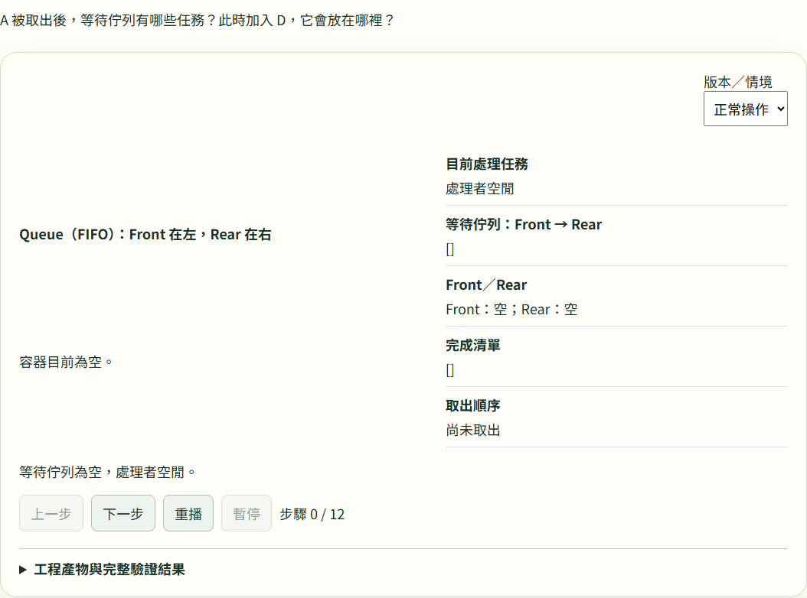
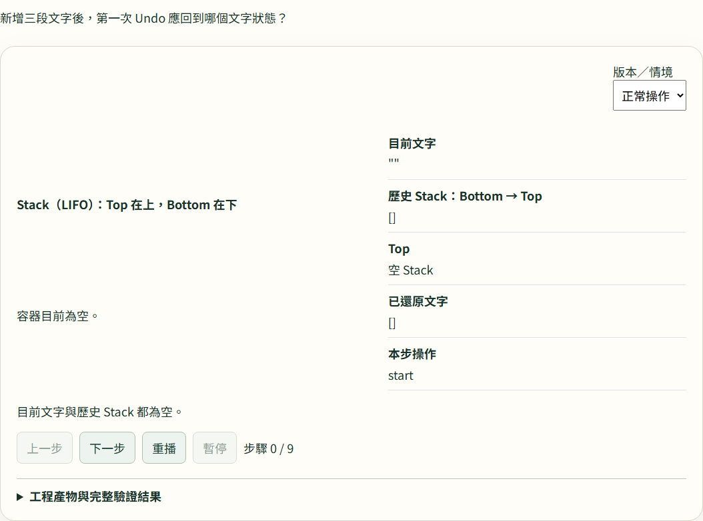

# AI 工程教學實驗室

用 Queue 任務排隊與 Stack 操作復原兩個互動案例，理解 **Prompt、Context、Harness、Loop、Graph** 五種 AI 工程思維。

適合大學生、初學者，以及想把 AI 工程概念連結到資料結構的讀者。製作：**JoannaLei**。

**[開啟 Queue 互動網站](https://ai-engineering-workshop-894946738433.asia-east1.run.app/?case=task-queue)** · **[開啟 Stack 互動網站](https://ai-engineering-workshop-894946738433.asia-east1.run.app/?case=stack-undo)** · **[下載 Windows EXE](AI-Engineering-Demo.exe)**

## 作品介紹

AI 工程不只是在提示詞中增加要求。這個作品把同一個資料結構任務拆成可操作、可比較、可檢查的教學情境，讓讀者觀察：需求是否清楚、資訊是否足夠、結果是否經過檢查、失敗後如何修正，以及條件改變時如何選擇工作路徑。

五種思維可以各自使用，也可以組合；頁面的教學順序不表示所有任務都必須依序執行五步。

## 教學目標

- 分辨 Prompt 的要求、Context 的資料，以及 Harness 的程式檢查各自扮演的角色。
- 理解「發現錯誤」與「修正後重新驗證」的差別，認識 Loop 的停止條件。
- 從忙碌、空容器等情境，理解 Graph 的條件分支、合流與工作路由。
- 透過 Queue 的 FIFO 與 Stack 的 LIFO，核對操作前後的狀態與規則。
- 用共同輸入、操作紀錄與驗證證據討論結果，而不只看最後一段答案。

## 兩個互動案例

| 案例 | 操作與觀察 | 教學安排 |
| --- | --- | --- |
| [Queue：任務排隊](https://ai-engineering-workshop-894946738433.asia-east1.run.app/?case=task-queue) | 觀察 A、B、C 排隊、處理 A 時加入 D，以及取出與完成的差別；比較忙碌與空佇列時的處理。 | 主要教學路徑，逐段操作五種工程做法的比較與揭曉。 |
| [Stack：操作復原](https://ai-engineering-workshop-894946738433.asia-east1.run.app/?case=stack-undo) | 編輯前保存文字，透過 Undo 觀察歷史堆疊與文字還原。 | 遷移練習，把 Queue 案例的判斷方式應用到另一種資料結構。 |

各段可以獨立操作與重設；完整回放可逐步前進、後退、重播或暫停，工程產物與完整驗證結果可另行展開。

## 作品畫面

以下為演講版實際操作畫面；畫面中的狀態取決於當時選擇的步驟與情境。

### Queue 任務排隊回放



### Stack 操作復原回放



延伸畫面：[Queue 的 Graph 條件路由比較](docs/screenshots/queue-graph-comparison.png) · [Stack 的工程做法比較](docs/screenshots/stack-comparison.png)。

## 設計貢獻

本作品的設計重點包括：

- **教學情境與案例編排**：以 Queue 為主路徑、Stack 為遷移練習，讓抽象工程概念對應到具體操作。
- **共同條件下的比較設計**：展示兩邊的提示詞、輸入資料與系統執行方式；Harness 比較是否檢查，Loop 比較修正前後，Graph 比較不同條件的路由。
- **狀態與證據的視覺化**：將容器、操作紀錄、偽程式碼與工程產物放在可逐步核對的介面中，分開表示取出、處理與完成。
- **可重現的互動體驗**：固定教材讓示範不依賴即時模型回覆，支援操作、揭曉、重設與回放。
- **線上與離線的交付整合**：網站與 Windows 下載包共用 Queue／Stack 教材與前端，方便演講展示及課後探索。

## Windows 離線版本

1. [下載 AI-Engineering-Demo.exe](AI-Engineering-Demo.exe)。
2. 雙擊 EXE，程式會開啟本機瀏覽器。
3. 若瀏覽器未自動開啟，前往 `http://127.0.0.1:8080`。

適用於 Windows 10／11、64 位元環境。使用既有 EXE 不需要安裝 Node.js、Python 或 C++ 開發工具。預設 Mock 教材不需要網路、帳號或 API key。

介面與教材已包在 EXE 中，不需解壓縮，也不需要配套資料夾或設定 `.env.example`。

若 8080 埠號已被使用，可在 EXE 所在資料夾開啟 PowerShell，執行：

```powershell
.\AI-Engineering-Demo.exe --port=8081
```

然後開啟 `http://127.0.0.1:8081`。使用期間請保持程式視窗開啟，結束時關閉它。

可用以下指令核對下載檔案，並與 [SHA256SUMS.txt](SHA256SUMS.txt) 比對：

```powershell
Get-FileHash -LiteralPath .\AI-Engineering-Demo.exe -Algorithm SHA256
```

## 示範方式與限制

- **Mock 是固定教材**：提示詞、比較結果與回放步驟已預先準備，不是當下呼叫 AI、執行學生程式或進行即時查詢。畫面中的檢查結果屬於標示的教材情境。
- **既有版本保留選用 Gemini Live**：需要使用者自己的 API key 與網路；模型回覆不會驅動固定教材的動畫、修正或驗證結果。金鑰會儲存在該網站的瀏覽器 `localStorage`，請求經由網站／本機程式轉送；使用公用電腦後應清除。
- 網站入口連結指向演講使用的既有部署；本資料夾的整理不代表重新部署，也不承諾網站永久可用。需要保存時請下載離線 EXE。
- 本次提供作品介紹、畫面、網站入口與 Windows 體驗包；沒有提供完整開發原始碼或完整版案例。

## 使用與權利說明

本作品供展示與學習使用，未採用開源授權。教材與程式的重製、修改、重新發布或用於其他專案，請先取得作者同意；適用法律及 GitHub 平台條款允許的範圍除外。公開可見不表示授權任意重用。

## 檔案與回饋

- `AI-Engineering-Demo.exe`：單檔 Windows 離線體驗版本。
- [SHA256SUMS.txt](SHA256SUMS.txt)：EXE 的 SHA-256 核對碼。
- `.env.example`：環境變數範本，沒有真實金鑰；直接執行 EXE 不需使用此檔案。
- `docs/screenshots/`：本頁引用的作品畫面。

回報問題時，請附 Windows／瀏覽器版本、案例、操作步驟與錯誤畫面；請勿附 API key、個資或機敏資料。
